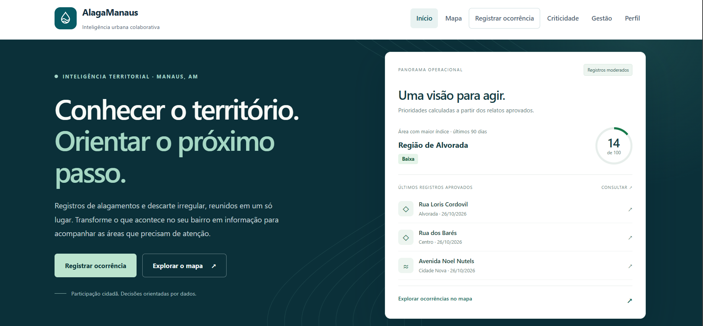
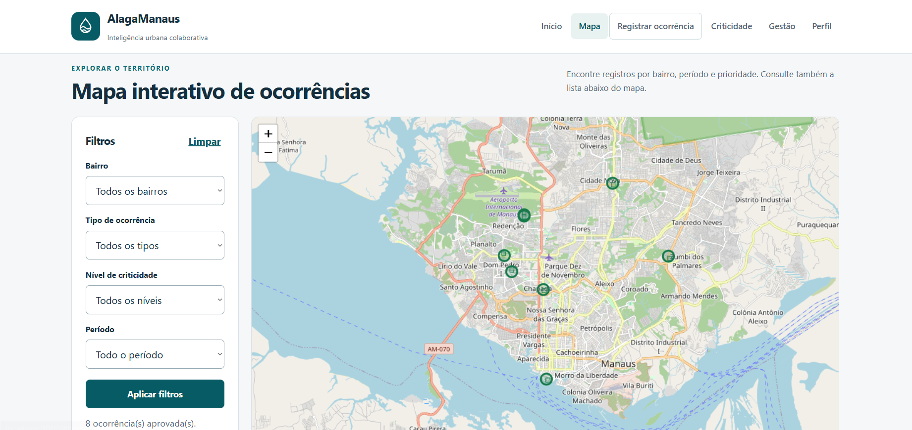
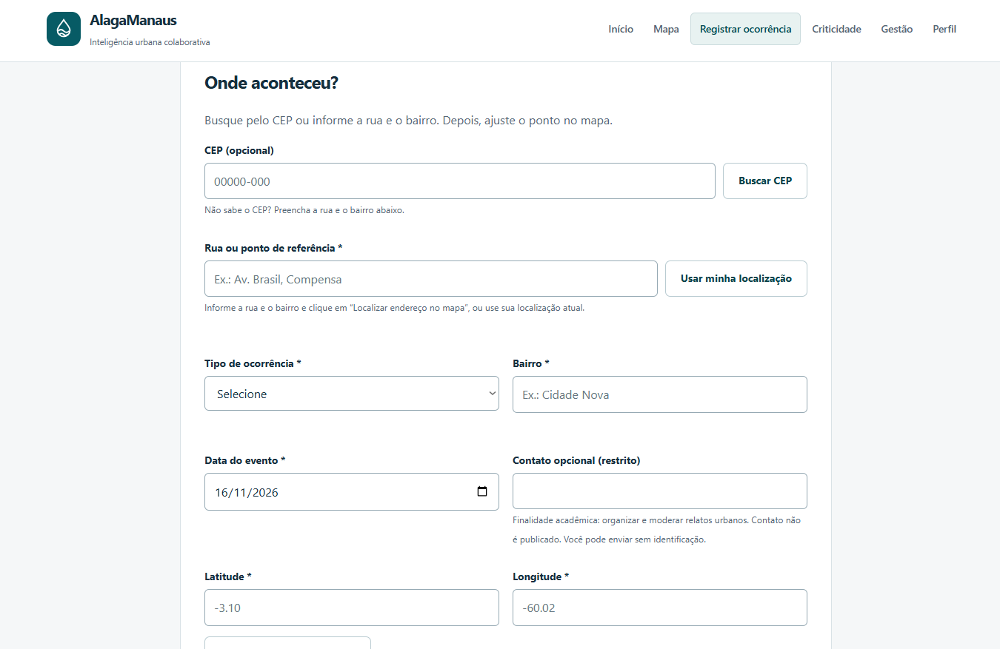
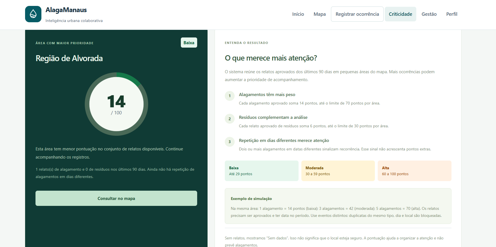
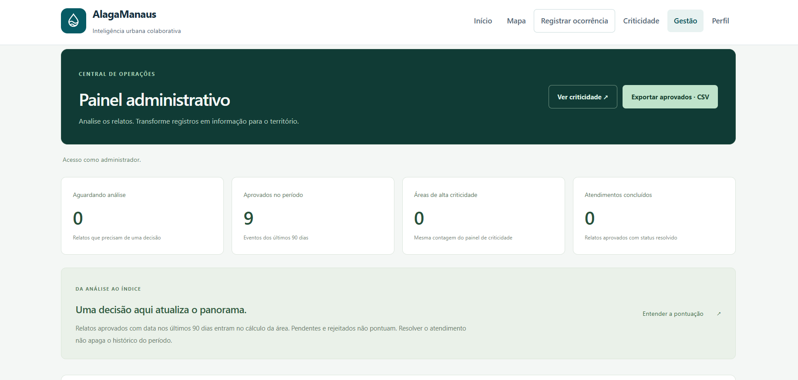
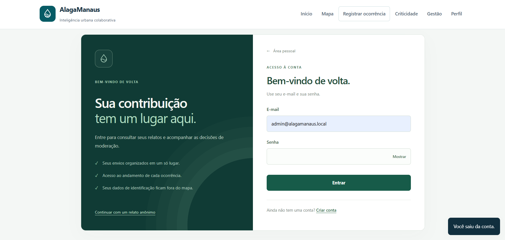

<div align="center">

# 🌧️ AlagaManaus

### Conhecer o território. Orientar o próximo passo.

Sistema georreferenciado para identificação e análise de pontos recorrentes de alagamento e descarte irregular de resíduos.


**Sistemas de Informação · CEUNI FAMETRO · Manaus/AM**

[Sobre](#sobre-o-projeto) · [Funcionalidades](#funcionalidades) · [Demonstração](#demonstração) · [Instalação](#instalação) · [Equipe](#equipe)

</div>

---

## Sobre o projeto

O **AlagaManaus** é um projeto acadêmico que reúne relatos georreferenciados de alagamento e descarte irregular de resíduos em Manaus. A proposta é organizar informações distribuídas entre diferentes locais da cidade e facilitar a consulta de ocorrências, a identificação de recorrências e a análise de áreas prioritárias.

A plataforma permite registrar ocorrências, consultar um mapa interativo e acompanhar indicadores de criticidade. Os relatos passam por moderação antes de aparecerem na consulta pública e integrarem o cálculo do índice.

### Objetivo

Desenvolver um sistema que apoie a identificação e a análise espacial desses problemas urbanos, aproximando a participação cidadã da organização de informações para a gestão urbana.

### Relação com a ODS 11

O projeto se alinha à **ODS 11 — Cidades e comunidades sustentáveis**, ao propor uma ferramenta de apoio à compreensão de problemas ambientais urbanos e à discussão de ações voltadas à resiliência e à qualidade de vida em Manaus.

> **Contexto acadêmico:** o AlagaManaus é um protótipo de pesquisa e desenvolvimento. Não é um canal oficial da Prefeitura ou da Defesa Civil e não substitui serviços de emergência.

## Funcionalidades

| Recurso | O que permite fazer |
| :--- | :--- |
| 📍 **Registro georreferenciado** | Informar o local pelo mapa ou por coordenadas, com apoio de localização do dispositivo e consulta de endereço por CEP. |
| 📝 **Relatos de ocorrências** | Registrar alagamentos ou descarte irregular de resíduos com título, descrição, bairro e data. |
| 📷 **Foto opcional** | Anexar uma imagem para complementar o relato. |
| 🗺️ **Mapa interativo** | Consultar ocorrências aprovadas e áreas classificadas por criticidade. |
| 🔎 **Filtros de consulta** | Refinar a visualização por bairro, período, tipo e classe de criticidade. |
| 🛡️ **Moderação** | Aprovar ou rejeitar relatos antes da publicação, com ações restritas ao administrador. |
| 📊 **Análise de criticidade** | Agrupar registros espacialmente e calcular um índice a partir de ocorrências aprovadas. |
| 📁 **Exportação** | Disponibilizar dados em CSV, JSON e GeoJSON para perfis autorizados. |
| 👤 **Conta e perfil** | Realizar cadastro, entrar no sistema, editar dados da conta e acompanhar relatos vinculados ao usuário. |
| 📱 **Interface responsiva** | Adaptar a navegação e os componentes a diferentes tamanhos de tela. |

O envio de relatos também pode ocorrer sem uma conta. Informações de contato são opcionais e não integram a saída pública dos registros.

## Demonstração

Seis telas do AlagaManaus, do registro cidadão à análise territorial. Os números apresentados correspondem ao estado da aplicação no momento das capturas.

### Visão inicial

Visão geral do projeto, atalhos para participação e panorama dos relatos aprovados.



### Explore as telas

Abra cada item para visualizar a captura e sua descrição.

<details>
<summary><strong>Mapa de ocorrências</strong></summary>

Consulta territorial com filtros por bairro, tipo, criticidade e período.



</details>

<details>
<summary><strong>Registro de ocorrência</strong></summary>

Trecho do formulário de localização, com consulta por CEP, localização do dispositivo e coordenadas.



</details>

<details>
<summary><strong>Análise de criticidade</strong></summary>

Apresentação do índice da área e explicação dos pesos, faixas e critérios de recorrência.



</details>

<details>
<summary><strong>Painel administrativo</strong></summary>

Panorama operacional para acompanhar relatos, aprovações e acesso à exportação de dados.



</details>

<details>
<summary><strong>Acesso à conta</strong></summary>

Tela de autenticação, com acesso ao cadastro e opção de continuar com um relato anônimo.



</details>

---

## Tecnologias

| Camada | Tecnologias e recursos |
| :--- | :--- |
| **Interface** | HTML5, CSS3 e JavaScript. |
| **Mapas** | Leaflet e mapas-base do OpenStreetMap. |
| **Localização e endereços** | Geolocation API do navegador, ViaCEP e Nominatim. |
| **Servidor** | Node.js 24+, módulos ES e servidor HTTP nativo do Node.js. |
| **Persistência local** | SQLite, por meio do módulo `node:sqlite`. |
| **Persistência alternativa** | PostgreSQL com PostGIS, configurado por `DATABASE_URL`. |
| **Processamento geográfico** | Proj4 e delimitação municipal em GeoJSON. |
| **Processamento de imagens** | Sharp. |
| **Testes** | Executor nativo do Node.js (`node:test`). |
| **Versionamento** | Git e GitHub. |

## Instalação

### Pré-requisitos

- **Node.js 24 ou superior**, conforme o `package.json`.
- **npm**, distribuído com o Node.js.
- **Git**, caso a obtenção do código seja feita por clonagem.
- Conexão com a internet para instalar dependências e utilizar mapas e serviços externos de endereço.

### 1. Obtenha o código

Na página deste repositório, selecione **Code → Download ZIP**, extraia o arquivo e abra um terminal na pasta que contém o `package.json`.

Se preferir usar Git, copie a URL HTTPS em **Code** e execute `git clone` seguido dessa URL. Depois, entre na pasta criada.

### 2. Instale as dependências

```bash
npm ci
```

### 3. Configure o ambiente

Copie o arquivo `.env.example` para um novo arquivo chamado `.env` na raiz do projeto.

**Windows — PowerShell:**

```powershell
Copy-Item .env.example .env
```

**Linux ou macOS:**

```bash
cp .env.example .env
```

No `.env`, ajuste `ADMIN_EMAIL` e `ADMIN_PASSWORD` para definir as credenciais administrativas antes da primeira execução. Para uso local, mantenha:

```env
PORT=3000
HOST=127.0.0.1
```

Sem `DATABASE_URL`, o sistema utiliza SQLite e cria o banco local em `var/alagamanaus.sqlite`. Para utilizar PostgreSQL, configure `DATABASE_URL` e disponibilize PostGIS no banco de destino.

**Não envie o arquivo `.env`, senhas ou o banco local para o GitHub.** O `.env.example` serve como referência de configuração.

### 4. Inicie a aplicação

```bash
npm start
```

Abra **http://127.0.0.1:3000** no navegador. Mantenha o terminal aberto enquanto utiliza a aplicação; para encerrar, pressione `Ctrl + C`.

<details>
<summary><strong>Windows: erro de execução do arquivo npm.ps1</strong></summary>

Se o PowerShell bloquear a execução de `npm.ps1`, utilize os comandos abaixo:

```powershell
npm.cmd ci
npm.cmd start
```

Para os testes, utilize `npm.cmd test`.

</details>

## Como usar

1. **Explore a página inicial:** consulte a proposta do projeto e os indicadores apresentados.
2. **Abra o mapa:** visualize os registros aprovados e aplique filtros de consulta.
3. **Registre uma ocorrência:** informe tipo, localização, bairro, data e descrição; adicione uma foto se necessário. Confira o ponto no mapa antes de enviar.
4. **Aguarde a moderação:** o relato permanece pendente até a avaliação administrativa.
5. **Acesse a gestão:** com a conta administrativa configurada no `.env`, analise os relatos e aprove ou rejeite a publicação.
6. **Consulte a criticidade:** observe as áreas classificadas e os registros que compõem a análise.
7. **Exporte os dados:** utilize um perfil autorizado para obter relatórios.

A consulta por CEP auxilia o preenchimento do endereço; a posição final da ocorrência deve ser conferida pelo usuário. A localização do dispositivo depende da permissão do navegador e de um contexto seguro, como localhost ou HTTPS.

## Como funciona a criticidade

O modelo **AM-1.0** divide o território em células de **250 × 250 metros** e considera ocorrências aprovadas em uma janela de **90 dias**.

O índice varia de **0 a 100**, com peso de **70% para alagamentos** e **30% para resíduos**. Cada quantidade é normalizada por cinco registros e limitada a 1:

```text
Índice = arredondar[100 × (0,7 × mínimo(A/5, 1) + 0,3 × mínimo(R/5, 1))]
```

`A` representa os registros de alagamento e `R`, os de resíduos, na mesma célula e no período considerado.

| Resultado | Classificação |
| :--- | :--- |
| De 0 a 29 | Baixa criticidade |
| De 30 a 59 | Criticidade moderada |
| De 60 a 100 | Alta criticidade |
| Sem registros elegíveis | Sem dados para classificação |

Uma célula apresenta **recorrência** quando possui registros de alagamento em pelo menos **duas datas distintas** dentro da janela analisada.

O índice organiza os relatos disponíveis para análise acadêmica. Não representa uma previsão de enchentes nem substitui uma avaliação técnica de risco. A ausência de relatos não comprova ausência de problemas em uma região.

## Estrutura do projeto

| Caminho | Responsabilidade |
| :--- | :--- |
| `index.html` | Estrutura das telas e navegação da aplicação. |
| `src/css/` | Estilos, responsividade e identidade visual. |
| `src/js/` | Interações, navegação, mapas e comunicação com a API. |
| `public/assets/` | Recursos estáticos, imagens e arquivos locais do Leaflet. |
| `backend/server.js` | Servidor HTTP, autenticação, autorização e endpoints. |
| `backend/db.js` | Persistência em SQLite ou PostgreSQL. |
| `backend/domain.js` | Validações, regras de negócio e cálculo de criticidade. |
| `backend/images.js` | Tratamento de imagens enviadas. |
| `backend/manaus.geojson` | Delimitação territorial utilizada na validação das coordenadas. |
| `docs/` | Documentação de API, requisitos, segurança e verificação. |
| `tests/` | Testes automatizados. |
| `.env.example` | Modelo das variáveis de ambiente. |
| `package.json` | Dependências, requisitos de execução e comandos. |
| `package-lock.json` | Registro das versões de dependências. |
| `compose.yaml` | Configuração auxiliar de serviços em contêiner. |

A pasta `var/` é gerada durante a execução e contém dados locais; não deve ser versionada.

## Testes e validação

Após instalar as dependências, execute:

```bash
npm test
```

O comando utiliza o executor de testes nativo do Node.js para executar os arquivos `tests/*.test.js`. A suíte inclui verificações de backend, interface e configuração de segurança.

Para o roteiro de verificações e os limites já documentados, consulte [Verificação do sistema](docs/VERIFICACAO.md). A execução dos testes não substitui a avaliação dos fluxos no navegador ou os testes com usuários.

## Segurança e privacidade

O projeto implementa controles como:

- Armazenamento de senhas com hash `scrypt` e salt individual.
- Sessões com cookies `HttpOnly` e `SameSite=Strict`.
- Autorização por perfil e moderação antes da publicação.
- Validação dos campos e das coordenadas dentro do município.
- Exclusão de informações de contato da saída pública das ocorrências.
- Processamento das imagens e remoção de metadados.

As medidas implementadas e as pendências para disponibilização pública estão descritas em [Segurança e privacidade](docs/SEGURANCA_E_PRIVACIDADE.md). A implantação pública exige configuração de HTTPS, revisão operacional e tratamento das pendências indicadas nesse documento.

## Documentação

| Documento | Conteúdo |
| :--- | :--- |
| [API](docs/API.md) | Endpoints e integração com o servidor. |
| [Requisitos](docs/REQUISITOS.md) | Rastreabilidade, regras de negócio e limites de validação. |
| [Segurança e privacidade](docs/SEGURANCA_E_PRIVACIDADE.md) | Controles implementados e atividades pendentes. |
| [Verificação](docs/VERIFICACAO.md) | Verificações e orientações de validação. |
| [UX/UI](docs/UX-UI.md) | Notas sobre a interface. |

## Contribuições

Sugestões de melhoria e relatos de problemas podem ser registrados na aba **Issues** deste repositório, quando habilitada. Ao relatar um erro, descreva os passos para reproduzi-lo, o resultado esperado e o comportamento observado.

Para propor alterações no código:

1. Crie um fork e uma branch para a alteração.
2. Implemente a mudança e execute os testes aplicáveis.
3. Abra um pull request explicando o problema, a solução e a validação realizada.

Evite incluir senhas, dados pessoais ou imagens de terceiros nos exemplos de teste.

## Equipe

| Integrante | Participação |
| :--- | :--- |
| **Jonas Ribeiro Rodrigues Junior** | Autor e desenvolvedor |
| **Alexsander Victor Silva Ferreira** | Autor e desenvolvedor |
| **Luana Leal** | Orientadora |

**Instituição:** CEUNI FAMETRO  
**Curso:** Sistemas de Informação  
**Local:** Manaus — Amazonas  
**Natureza:** Projeto acadêmico / Trabalho de Conclusão de Curso

## Licença

Este projeto ainda não possui uma licença própria de distribuição definida. As licenças dos componentes de terceiros permanecem aplicáveis aos respectivos componentes; a licença do Leaflet está disponível em [LEAFLET-LICENSE.txt](public/assets/LEAFLET-LICENSE.txt).

## Agradecimentos

À orientadora Luana Leal e ao CEUNI FAMETRO pelo acompanhamento acadêmico, e às comunidades e serviços que disponibilizam recursos utilizados no projeto, incluindo Node.js, Leaflet, OpenStreetMap, Nominatim e ViaCEP.

---

<div align="center">

**AlagaManaus** · Tecnologia e participação cidadã para compreender a cidade.

</div>
